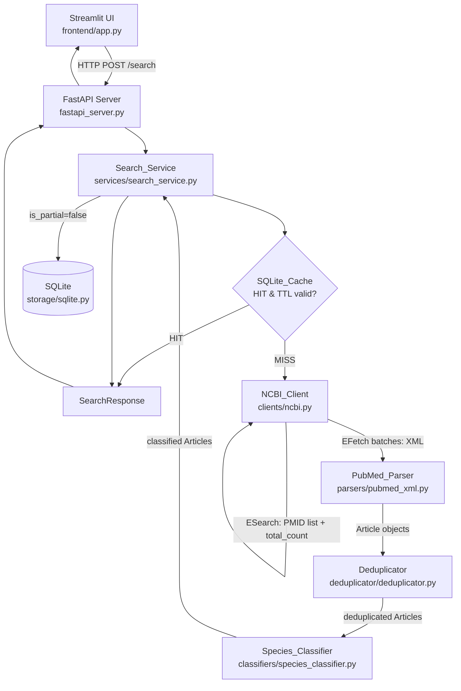
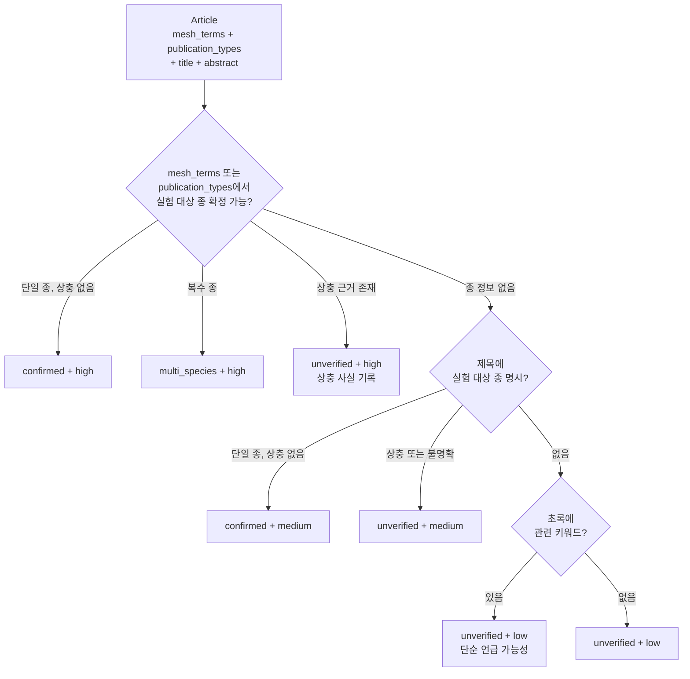
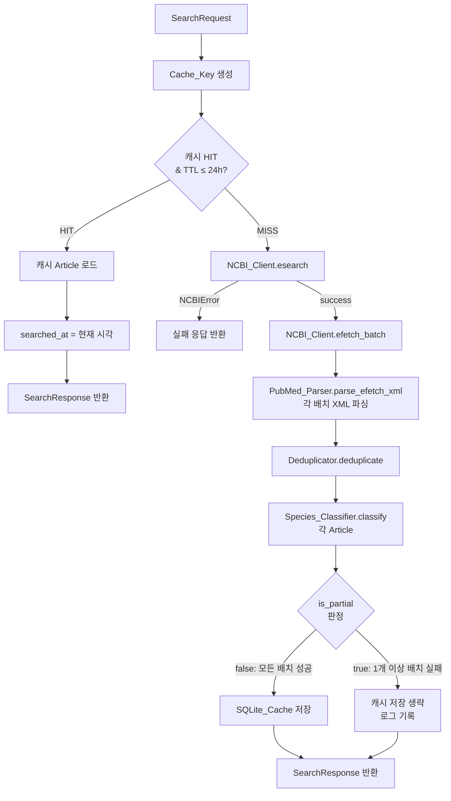

# Design Document

## Overview

Canine Evidence Engine은 반려동물(초기: 개) 유전자·변이 관련 PubMed 논문을 검색하고, 연구 대상 종과 출처를 명확히 구분하여 검증 가능한 형태로 제공하는 Python 기반 연구 검색 보조 서비스이다.

사용자는 Streamlit UI에서 유전자명과 검색 조건을 입력하고, FastAPI 백엔드를 통해 NCBI E-utilities API로 PubMed 논문을 수집한다. 수집된 논문은 파싱·중복 제거·종 분류를 거쳐 SQLite에 캐시되며, 출판연도 내림차순으로 논문 카드 형태로 표시된다.

### 설계 원칙

- **Pythonic한 구조**: Python 3.12와 Conda를 기준으로 하며 Java Spring 구조를 기계적으로 옮기지 않는다. 작은 기능과 상태 없는 로직은 함수로 구현하고, 상태 관리나 외부 자원 연결이 필요할 때만 동작을 가진 클래스를 사용한다. 데이터 묶음에는 필요한 경우 표준 dataclass를 사용한다.
- **단일 프로젝트·저장소**: 프론트엔드는 `frontend/`, 백엔드는 `src/canine_evidence/`에 배치하고 하나의 프로젝트 루트와 Git 저장소에서 관리한다.
- **최소한의 계층**: Interface/Impl, Service/Repository, DTO 변환 계층을 관성적으로 추가하지 않는다. NCBI 호출, XML 파싱, 종 분류, 캐시, 검색 흐름의 책임을 구분하되 불필요한 파일·폴더·추상화를 만들지 않는다.
- **도구의 역할**: 표준 라이브러리와 타입 힌트를 적극 활용하고 Pydantic은 API 입력·출력 검증에 사용한다. FastAPI, Streamlit, SQLAlchemy 선택을 유지한다.
- **유지보수성과 검증**: 코드 길이보다 가독성, 유지보수성, 테스트 용이성을 우선한다. pytest 기반 테스트와 필요한 외부 API Mock 검증을 작성·실행한다.
- **변경 설명**: 새로운 요구사항으로 이 문서와 구현 구조가 달라질 경우 구현 전에 차이를 설명한다. 사용자 요청 없이 요구사항·설계 문서를 임의로 변경하지 않는다.
- **출처 보존 우선**: 모든 Article 필드는 NCBI API 응답에서 직접 매핑한다. 없는 필드는 null로 저장하며, 임의 생성·추론하지 않는다.
- **종 분류 보수성**: 실험 대상 종이 확인되지 않으면 `unverified`를 기본으로 부여한다. MeSH 용어 포함이 곧 실험 대상 종 확정을 의미하지 않는다.
- **책임 분리**: NCBI API 호출(NCBI_Client), XML 파싱(PubMed_Parser), 오케스트레이션(Search_Service)의 책임을 명확히 분리한다.
- **MVP 범위 준수**: AI 요약, 복잡한 인증, 클라우드 인프라는 포함하지 않는다.
- **오류 투명성**: API 오류, 부분 성공, 검색 결과 없음을 각각 다른 응답으로 구분한다.

> 위 구조 원칙은 이후 모든 개발에 지속 적용한다. 아래 컴포넌트 이름과 클래스 예시는 책임을 설명하는 초안이며, 동일한 클래스나 계층 생성을 강제하지 않는다. 1단계에서는 상태 없는 `PubMedParser` 대신 `parse_efetch_xml()` 함수, `services/` 계층 대신 패키지 루트의 `query_builder.py`를 사용한다. NCBIClient와 RateLimiter는 연결·상태 관리가 필요하므로 클래스로 유지한다. 이 원칙의 추가는 작업 범위를 확장하지 않으며, 현재 합의된 범위는 PubMed 검색·XML 파싱 검증까지다. 이후 단계는 별도 요청이 있을 때 진행한다.

## Architecture



### 계층 설명

| 계층 | 모듈 | 책임 |
|------|------|------|
| UI | `frontend/app.py` | Streamlit 검색 폼, 논문 카드, 오류 메시지 표시 |
| API | `src/canine_evidence/api.py` | FastAPI 라우터, 요청 수신, HTTP 오류 코드 반환 |
| Service | `services/search_service.py` | 캐시 조회, NCBI 호출 오케스트레이션, 캐시 저장 |
| Client | `clients/ncbi.py` | ESearch/EFetch 호출, 속도 제한, 재시도, 타임아웃 |
| Parser | `parsers/pubmed_xml.py` | NCBI XML/JSON → Article 변환 (MeSH 용어·Publication Type 포함) |
| Classifier | `classifiers/species_classifier.py` | 종 분류 로직 (구조화된 메타데이터 우선) |
| Deduplicator | `deduplicator/deduplicator.py` | PMID 기반 중복 제거 |
| Storage | `storage/sqlite.py` | SQLAlchemy 모델, CRUD, 캐시 TTL 판단 |
| Config | `config.py` | 환경변수 로드, 설정 관리 |

## Components and Interfaces

### 1. NCBI_Client (`clients/ncbi.py`)

외부 NCBI E-utilities API 호출만 담당한다. 비즈니스 로직을 포함하지 않는다.

```python
class NCBIClient:
    def __init__(self, email: str, api_key: str | None = None) -> None: ...

    async def esearch(
        self,
        query: str,
        db: str = "pubmed",
        retmax: int = 200,
        timeout: float = 30.0,
    ) -> ESearchResult: ...
    # 반환: {"pmids": list[str], "total_count": int, "query_translation": str}

    async def efetch_batch(
        self,
        pmids: list[str],
        batch_size: int = 100,
        timeout: float = 30.0,
    ) -> EFetchBatchResult: ...
    # 반환: {"xml_responses": list[str], "failed_pmids": list[str]}
```

**EFetch 배치 크기**: EFetch 단일 요청당 최대 PMID 수는 100으로 제한한다. limit=200인 경우 배치 2회 호출이 발생한다. ESearch의 retmax는 limit 값을 그대로 사용하며, PubMed ESearch는 retmax 최대 10,000까지 허용한다.

**속도 제한 구현**: `asyncio` 기반 토큰 버킷 — API 키 없으면 3 req/s, 있으면 10 req/s. 재시도 중에도 속도 제한을 유지한다.

**재시도 정책**:
- HTTP 429: 지수 백오프(1s → 2s → 4s), 최대 3회. 소진 시 `NCBIRateLimitError` 발생
- HTTP 5xx: 최대 2회 재시도. 소진 시 `NCBIServerError` 발생
- 타임아웃: `httpx.TimeoutException` → `NCBITimeoutError` 발생

### 2. PubMed_Parser (`parsers/pubmed_xml.py`)

NCBI XML 응답을 `Article` 객체로 변환한다. 네트워크 호출을 수행하지 않는다. **Species_Classifier가 종 분류에 사용할 구조화된 메타데이터(MeSH 용어, Publication Type)를 Article에 포함하여 반환한다.**

```python
class PubMedParser:
    def parse_efetch_xml(self, xml_text: str) -> list[Article]: ...
    # 파싱 불가 시 ParseError 발생 (Article 미생성)
    # PMID 없는 항목은 제외하고 경고 로그 기록
```

**필드 매핑 규칙**:
- `pmid`: `<PMID>` 태그 값. 없으면 해당 항목 전체 제외
- `doi`: `<ArticleId IdType="doi">` 값. 없으면 null
- `title`: `<ArticleTitle>` 값. 없으면 null
- `abstract`: `<AbstractText>` 값. 없으면 null, `abstract_available=False`
- `authors`: `<AuthorList>` 에서 `LastName + ForeName` 리스트. 없으면 빈 리스트
- `publication_year`: `<PubDate><Year>` 값. 없으면 null
- `journal`: `<Journal><Title>` 값. 없으면 null
- `source_url`: `https://pubmed.ncbi.nlm.nih.gov/{pmid}/` (pmid가 null이면 null)
- `ncbi_retrieved_at`: 파서 호출 시각 (UTC ISO 8601)
- `mesh_terms`: `<MeshHeadingList>` 내 `<DescriptorName>` 값 목록. 없으면 빈 리스트
- `publication_types`: `<PublicationTypeList>` 내 `<PublicationType>` 값 목록. 없으면 빈 리스트

### 3. Deduplicator (`deduplicator/deduplicator.py`)

```python
class Deduplicator:
    def deduplicate(self, articles: list[Article]) -> DeduplicationResult: ...
    # 반환: {"articles": list[Article], "removed_count": int, "warnings": list[str]}
```

**처리 규칙**:
1. PMID가 null인 Article → 결과 제외, 경고 로그
2. 동일 PMID → 첫 번째 항목 유지, 나머지 제거
3. PMID가 다르지만 동일한 non-null DOI → 둘 다 포함, 경고 로그
4. 결과 목록 내 모든 PMID는 non-null 및 고유함이 보장됨

### 4. Species_Classifier (`classifiers/species_classifier.py`)

**Article에 포함된 `mesh_terms`와 `publication_types`를 1차 근거로 사용하고, `title`과 `abstract`를 2차 보조 근거로 사용한다.**

```python
class SpeciesClassifier:
    def classify(self, article: Article) -> SpeciesClassification: ...
    # 반환: {
    #   "status": SpeciesStatus,
    #   "evidence_strength": SpeciesEvidenceStrength,
    #   "evidence_notes": list[str],   # 사용된 MeSH 용어 또는 키워드
    # }
```

**분류 흐름**:



**`confirmed` 부여 조건** (AND):
- 조건 A: 해당 종이 단순 언급이나 비교 대상이 아닌 실험 대상(subject of experiment)임을 나타내는 근거가 1차(구조화된 메타데이터) 또는 2차(제목) 출처에 존재
- 조건 B: 다른 종이 실험 대상임을 나타내는 상충 근거가 없음

둘 중 하나라도 미충족 시 `unverified`.

**MeSH 용어와 종 확정**: MeSH Descriptor에 "Dogs", "Cats", "Humans" 등이 포함되어 있다고 해서 해당 종이 실험 대상임이 확정되지 않는다. "Dogs — genetics" 같이 해당 종이 연구 주제임을 명시하는 맥락이 있거나, `publication_types`에 "Animal Study" 등이 포함된 경우에 한해 실험 대상 근거로 사용한다.

**단순 언급 구분**: "compared to dogs", "unlike canine models"처럼 비교 맥락의 키워드는 실험 대상 근거로 사용하지 않음.

**초록 키워드 처리**: 초록에서 종 키워드가 감지되면 항상 `unverified`로 처리한다. 초록만으로는 실험 대상 종을 확정하지 않는다.

### 5. Search_Service (`services/search_service.py`)

전체 검색 흐름을 오케스트레이션한다.

```python
class SearchService:
    async def search(self, request: SearchRequest) -> SearchResponse: ...
```

**처리 흐름**:



**EFetch 배치 실패 분류 및 is_partial 판정**:

| 상황 | 설명 | is_partial | articles | HTTP |
|------|------|-----------|----------|------|
| 모든 배치 성공 | EFetch 전체 성공 | false | 전체 Article | 200 |
| 일부 배치 실패 (1개 이상 성공) | 성공 배치 결과만 반환 | true | 성공 배치 Article | 200 |
| 첫 번째 배치 포함 모든 배치 실패 | 0건 반환, 전체 실패 | — | — | 502/503 |

> 첫 번째 배치를 포함해 모든 배치가 실패하면 부분 성공이 아닌 전체 실패로 처리하여 4xx/5xx를 반환한다. 성공한 배치가 1개 이상인 경우에만 is_partial=true로 200 응답을 반환한다.

**배치 크기와 limit 관계**:
- `limit=200` → ESearch retmax=200, EFetch 배치 2회 (각 100건)
- `limit=100` → ESearch retmax=100, EFetch 배치 1회 (100건)
- `limit=50` → ESearch retmax=50, EFetch 배치 1회 (50건)

**캐시 저장 조건**: `is_partial=false`인 경우에만 SQLite_Cache에 저장한다.

### 6. FastAPI Server (`src/canine_evidence/api.py`)

```python
@app.post("/search", response_model=SearchResponse)
async def search(request: SearchRequest) -> SearchResponse: ...
```

**HTTP 오류 매핑**:

| 상황 | HTTP 코드 |
|------|-----------|
| 유전자명 유효성 오류 (빈 값, 200자 초과) | 422 |
| 타임아웃, 네트워크 오류, 429 재시도 소진 | 503 |
| 5xx 재시도 소진 또는 모든 EFetch 배치 실패 | 502 |
| 서버 내부 오류 | 500 |

### 7. Streamlit UI (`frontend/app.py`)

```
┌─────────────────────────────────────────────────┐
│  Canine Evidence Engine                         │
│  ┌──────────────────────────────────────┐       │
│  │ 유전자명 *  [BRAF            ]        │       │
│  │ 종       *  [Dog ▼]                  │       │
│  │ 연도 범위*  [2015] ~ [2026]           │       │
│  │ 암종 키워드 [               ]  [검색] │       │
│  └──────────────────────────────────────┘       │
│                                                 │
│  검색 기준: NCBI PubMed | 검색 시각: 2024-01-15T09:30:00Z │
│  전체 검색 건수: 42 | 표시: 20건                │
│                                                 │
│  ── dog_confirmed (5건) ──────────────────────  │
│  ┌────────────────────────────────────────────┐ │
│  │ [dog_confirmed] BRAF V595E in Canine ...   │ │
│  │ 2023 | Cancer Research | PMID: 37XXXXXX   │ │
│  │ 초록: ... [PubMed 원문 ↗]                  │ │
│  └────────────────────────────────────────────┘ │
│  ── unverified (15건) ────────────────────────  │
│  ┌────────────────────────────────────────────┐ │
│  │ [종 미확인] BRAF mutation in ...           │ │
│  │ ...                                        │ │
│  └────────────────────────────────────────────┘ │
└─────────────────────────────────────────────────┘
```

## Data Models

### Pydantic 모델 (`models/`)

```python
from enum import Enum
from datetime import datetime
from pydantic import BaseModel, Field

class SpeciesStatus(str, Enum):
    DOG_CONFIRMED = "dog_confirmed"
    CAT_CONFIRMED = "cat_confirmed"
    HUMAN_CONFIRMED = "human_confirmed"
    MULTI_SPECIES = "multi_species"
    UNVERIFIED = "unverified"

class SpeciesEvidenceStrength(str, Enum):
    HIGH = "high"
    MEDIUM = "medium"
    LOW = "low"

class Article(BaseModel):
    pmid: str
    doi: str | None = None
    title: str | None = None
    abstract: str | None = None
    abstract_available: bool
    authors: list[str] = Field(default_factory=list)
    publication_year: int | None = None
    journal: str | None = None
    source_url: str | None = None
    ncbi_retrieved_at: datetime                      # NCBI에서 수집한 시각 (UTC)
    # --- 구조화된 메타데이터 (PubMed_Parser가 채움, Species_Classifier가 사용) ---
    mesh_terms: list[str] = Field(default_factory=list)
    # <MeshHeadingList> 내 <DescriptorName> 값 목록. 없으면 빈 리스트.
    publication_types: list[str] = Field(default_factory=list)
    # <PublicationTypeList> 내 <PublicationType> 값 목록. 없으면 빈 리스트.
    # --- 종 분류 결과 (Species_Classifier가 채움) ---
    species_status: SpeciesStatus = SpeciesStatus.UNVERIFIED
    species_evidence_strength: SpeciesEvidenceStrength = SpeciesEvidenceStrength.LOW
    species_evidence_notes: list[str] = Field(default_factory=list)
    # 분류에 사용된 MeSH 용어 또는 키워드 목록

class SearchRequest(BaseModel):
    gene: str = Field(..., min_length=1, max_length=200)
    species: str = Field(default="all")   # "dog" | "cat" | "human" | "all"
    year_from: int | None = None
    year_to: int | None = None
    cancer_keyword: str | None = None
    limit: int = Field(default=20, ge=1, le=200)

class SearchResponse(BaseModel):
    articles: list[Article]
    total_count: int             # ESearch 전체 검색 건수
    returned_count: int          # 실제 반환된 논문 건수
    searched_at: datetime        # 현재 요청 시각 (UTC) — 캐시 반환 시에도 현재 시각
    query_string: str            # 사용된 PubMed 검색식
    is_partial: bool = False     # EFetch 일부 배치 실패 여부 (성공 배치 1개 이상일 때만 true)
    failed_pmids: list[str] = Field(default_factory=list)
    from_cache: bool = False
```

### SQLAlchemy 모델 (`storage/sqlite.py`)

```python
from sqlalchemy import Column, String, Integer, Boolean, DateTime, ForeignKey, Text
from sqlalchemy.orm import DeclarativeBase, relationship

class Base(DeclarativeBase): ...

class ArticleORM(Base):
    __tablename__ = "articles"
    pmid                        = Column(String, primary_key=True)
    doi                         = Column(String, nullable=True)
    title                       = Column(Text, nullable=True)
    abstract                    = Column(Text, nullable=True)
    abstract_available          = Column(Boolean, nullable=False)
    authors_json                = Column(Text, nullable=False)     # JSON 직렬화
    publication_year            = Column(Integer, nullable=True)
    journal                     = Column(Text, nullable=True)
    source_url                  = Column(String, nullable=True)
    ncbi_retrieved_at           = Column(DateTime, nullable=False) # UTC
    mesh_terms_json             = Column(Text, nullable=False)     # JSON 직렬화 (빈 리스트 허용)
    publication_types_json      = Column(Text, nullable=False)     # JSON 직렬화 (빈 리스트 허용)
    species_status              = Column(String, nullable=False)
    species_evidence_strength   = Column(String, nullable=False)
    species_evidence_notes_json = Column(Text, nullable=False)     # JSON 직렬화

class SearchCacheORM(Base):
    __tablename__ = "search_cache"
    cache_key      = Column(String, primary_key=True)
    gene           = Column(String, nullable=False)
    species        = Column(String, nullable=False)
    year_from      = Column(Integer, nullable=True)
    year_to        = Column(Integer, nullable=True)
    cancer_keyword = Column(String, nullable=True)
    limit          = Column(Integer, nullable=False)
    cached_at      = Column(DateTime, nullable=False)    # UTC, TTL 판단 기준
    total_count    = Column(Integer, nullable=False)
    returned_count = Column(Integer, nullable=False)
    query_string   = Column(Text, nullable=False)
    cache_articles = relationship("SearchCacheArticleORM", back_populates="cache")

class SearchCacheArticleORM(Base):
    __tablename__ = "search_cache_articles"
    cache_key  = Column(String, ForeignKey("search_cache.cache_key"), primary_key=True)
    pmid       = Column(String, ForeignKey("articles.pmid"), primary_key=True)
    sort_order = Column(Integer, nullable=False)   # 출판연도 내림차순 정렬 보존
    cache      = relationship("SearchCacheORM", back_populates="cache_articles")
```

### PubMed 검색식 구성

**유효한 PubMed 필드 태그** ([PubMed Help](https://pubmed.ncbi.nlm.nih.gov/help/) 기준):

| 태그 | 의미 | 비고 |
|------|------|------|
| `[tiab]` | Title/Abstract | 제목과 초록 전문 검색 |
| `[ti]` | Title | 제목만 검색 |
| `[MeSH Terms]` | MeSH 용어 | MEDLINE 인덱싱 논문에만 적용 |
| `[All Fields]` | 전체 필드 | 자동 용어 매핑 포함 |
| `[pdat]` | Publication Date | 연도 범위: `2015:2026[pdat]` |
| `[pt]` | Publication Type | 예: `"Review"[pt]` |

> **주의**: `[Gene Name]`은 PubMed ESearch에서 유효하지 않은 필드 태그이다. 유전자명 검색에는 `[tiab]`(제목/초록 검색, 권장) 또는 `[All Fields]`를 사용한다.

```python
def build_query(request: SearchRequest) -> str:
    """
    PubMed 검색식을 구성한다.
    유전자명은 [tiab]으로 제목/초록을 검색한다.
    종 필터는 MeSH Terms를 사용하되, 검색 범위를 좁히는 용도로만 사용한다.
    """
    parts = [f'"{request.gene}"[tiab]']   # [Gene Name]은 유효하지 않음
    if request.species in ("dog", "cat"):
        species_mesh = {"dog": "Dogs[MeSH Terms]", "cat": "Cats[MeSH Terms]"}
        parts.append(species_mesh[request.species])
    elif request.species == "human":
        parts.append("Humans[MeSH Terms]")
    if request.cancer_keyword:
        parts.append(f'"{request.cancer_keyword}"[tiab]')
    if request.year_from or request.year_to:
        y_from = request.year_from or 1900
        y_to = request.year_to or 2100
        parts.append(f"{y_from}:{y_to}[pdat]")
    return " AND ".join(parts)
```

**검색어 검증 규칙**:
- `gene` 필드: 영문자·숫자·하이픈·슬래시만 허용 (공백 허용). 길이 1–200자. 특수문자(`"`, `[`, `]`, `(`, `)`)가 포함된 경우 검색식에서 이스케이프 처리.
- `cancer_keyword` 필드: 빈 문자열이면 검색식에서 제외. 길이 1–200자.
- `year_from` / `year_to`: 1800–현재 연도 범위. `year_from > year_to`인 경우 422 반환.

**유전자명 검색 실제 유효성 확인 방법**:
BRAF, TP53 등 유전자명은 PubMed에서 전문 용어로 등재되어 있어 `[tiab]` 태그로 충분히 검색된다. 구현 단계에서 아래 테스트를 실제 NCBI API로 검증한다 (테스트 계획 섹션 참조).

### 시간 필드 3종 구분 요약

| 필드 | 저장 위치 | 의미 |
|------|-----------|------|
| `ncbi_retrieved_at` | `ArticleORM` | NCBI API에서 해당 Article을 수집한 시각 (UTC) |
| `cached_at` | `SearchCacheORM` | 검색 결과를 SQLite에 저장한 시각 (UTC). TTL 판단에 사용 |
| `searched_at` | `SearchResponse`(DB 저장 안 함) | 사용자가 현재 검색 요청을 실행한 시각 (UTC). 캐시 반환 시에도 현재 시각으로 설정 |

### Cache_Key 생성 방식

```python
import hashlib, json

def make_cache_key(request: SearchRequest) -> str:
    normalized = {
        "gene": request.gene.strip().upper(),
        "species": request.species,
        "year_from": request.year_from,
        "year_to": request.year_to,
        "cancer_keyword": (request.cancer_keyword or "").strip().lower() or None,
        "limit": request.limit,
    }
    payload = json.dumps(normalized, sort_keys=True)
    return hashlib.sha256(payload.encode()).hexdigest()
```

**캐시 TTL 판단**:

```python
from datetime import datetime, timezone, timedelta

def is_cache_valid(cached_at: datetime) -> bool:
    return datetime.now(timezone.utc) - cached_at < timedelta(hours=24)
```

## Correctness Properties

### Property 1: Article 직렬화 라운드 트립

*For any* 유효한 NCBI API XML 응답에서 파싱된 Article 객체에 대해, JSON으로 직렬화한 후 다시 역직렬화하면, PMID, DOI, title, abstract, abstract_available, authors, publication_year, journal, source_url, ncbi_retrieved_at, mesh_terms, publication_types 모든 필드가 원본 Article 객체와 동일한 값을 가지는 Article 객체가 생성된다.

**Validates: Requirements 2.6**

---

### Property 2: 중복 제거 멱등성

*For any* Article 목록에 대해 Deduplicator를 두 번 연속 적용하면, 두 번째 적용 결과가 첫 번째 적용 결과와 동일한 Article 목록(동일한 PMID 순서와 내용)을 반환한다.

**Validates: Requirements 3.5**

---

### Property 3: 중복 제거 후 PMID 고유성 보장

*For any* Article 목록(PMID가 null인 항목이 포함될 수 있음)에 대해 Deduplicator를 적용하면, 결과 목록 내 모든 PMID 값은 non-null이고 서로 고유하다.

**Validates: Requirements 3.4**

---

### Property 4: 종 분류 상충 시 unverified 보장

*For any* Article에서 구조화된 메타데이터(mesh_terms, publication_types)와 제목 키워드가 서로 다른 종을 실험 대상으로 가리키는 경우, Species_Classifier는 반드시 `unverified` 상태를 부여하고 상충 사실을 evidence_notes에 기록한다.

**Validates: Requirements 4.5**

---

### Property 5: 분류 근거 보존

*For any* Article에 대해 mesh_terms, publication_types, title, abstract 중 하나 이상이 non-empty인 경우, Species_Classifier가 종 분류를 수행한 결과의 evidence_notes에는 분류 판단에 사용된 MeSH 용어 또는 키워드가 하나 이상 포함된다.

**Validates: Requirements 4.7**

---

### Property 6: source_url 형식 불변성

*For any* non-null PMID를 가진 Article에 대해, PubMed_Parser가 생성하는 source_url은 반드시 `https://pubmed.ncbi.nlm.nih.gov/{pmid}/` 형식을 따른다. PMID가 null인 경우 source_url도 반드시 null이다.

**Validates: Requirements 2.5, 8.4**

---

### Property 7: 캐시 키 결정론적 생성

*For any* SearchRequest에 대해 make_cache_key를 여러 번 호출하면 항상 동일한 Cache_Key를 반환한다. 또한 gene 대소문자나 cancer_keyword 앞뒤 공백이 다른 두 SearchRequest가 정규화 후 동일한 내용을 가지면 동일한 Cache_Key를 반환한다.

**Validates: Requirements 7.1**

## Error Handling

### 오류 유형 분류

| 오류 유형 | 발생 위치 | 처리 방식 | 최종 HTTP 코드 |
|-----------|-----------|-----------|----------------|
| 유전자명 유효성 오류 | FastAPI (Pydantic) | 즉시 422 반환 | 422 |
| NCBI 타임아웃 | NCBI_Client | `NCBITimeoutError` 발생 → Search_Service 중단 | 503 |
| NCBI 429 재시도 소진 | NCBI_Client | `NCBIRateLimitError` 발생 | 503 |
| NCBI 5xx 재시도 소진 | NCBI_Client | `NCBIServerError` 발생 | 502 |
| XML 파싱 불가 | PubMed_Parser | `ParseError` 발생 → Search_Service 중단 | 500 |
| EFetch 모든 배치 실패 | Search_Service | 전체 실패로 처리 | 502 |
| EFetch 일부 배치 실패 (1개 이상 성공) | Search_Service | `is_partial=true`, 성공 배치만 포함, 캐시 저장 생략 | 200 |
| SQLite 저장 오류 | Storage | 로그 기록, 검색 결과 반환에 영향 없음 | 200 |
| 검색 결과 0건 | Search_Service | 빈 목록 + "설정한 조건에서 검색된 연구 없음" | 200 |

### 오류 응답 구조

```python
# HTTP 4xx/5xx 반환 시 FastAPI 오류 응답
{
    "detail": "NCBI API 요청 타임아웃 (30초 초과)",
    "error_type": "timeout"   # "timeout" | "rate_limit" | "server_error" | "parse_error" | "efetch_all_failed"
}
```

### 부분 성공(is_partial) 흐름

limit=200, 배치 크기=100인 경우 (배치 2회 발생):

```
EFetch 배치 1 (PMID 1~100):   성공 → 100건 파싱 완료
EFetch 배치 2 (PMID 101~200): 실패 → failed_pmids에 101~200 추가
결과: articles=[배치1 결과 N건], is_partial=true, failed_pmids=[PMID 101..200]
캐시 저장: 생략

EFetch 배치 1 (PMID 1~100):   실패
EFetch 배치 2 (PMID 101~200): 실패
결과: 전체 실패 → HTTP 502 반환 (is_partial 사용 안 함)
```

### Streamlit UI 오류 표시 규칙

| 상황 | 표시 메시지 |
|------|-------------|
| HTTP 503 | "NCBI API에 일시적으로 연결할 수 없습니다. 잠시 후 재시도해 주세요." |
| HTTP 502 | "NCBI 서버 오류가 발생했습니다. 잠시 후 재시도해 주세요." |
| is_partial=true | "일부 논문 데이터를 불러오지 못했습니다. (실패 PMID: N건)" |
| 0건 정상 응답 | "설정한 조건에서 검색된 연구 없음" |
| SQLite 저장 오류 | 사용자에게 표시하지 않음 (로그만 기록) |

검색 중 오류 발생 시 이전에 입력한 검색 조건 값을 유지한다.

## Testing Strategy

### 테스트 구조

```text
tests/
├── fixtures/
│   ├── sample_efetch_with_mesh.xml      # MeSH 용어·Publication Type 포함 샘플
│   ├── sample_efetch_no_abstract.xml    # 초록 없는 샘플
│   ├── sample_efetch_no_doi.xml         # DOI 없는 샘플
│   ├── sample_efetch_no_mesh.xml        # MeSH 없는 샘플 (unverified 경로)
│   └── sample_efetch_invalid.xml        # 파싱 불가 샘플
├── test_pubmed_parser.py                # PubMed_Parser 단위 테스트 + PBT
├── test_deduplicator.py                 # Deduplicator 단위 테스트 + PBT
├── test_species_classifier.py           # Species_Classifier 단위 테스트 + PBT
├── test_search_service.py               # Search_Service Mock 기반 테스트
├── test_ncbi_client.py                  # NCBI_Client Mock 기반 테스트
├── test_cache.py                        # SQLite_Cache 단위 테스트
├── test_query_builder.py                # build_query 검색식 검증 테스트
└── test_api.py                          # FastAPI 통합 테스트 (httpx TestClient)
```

### 단위 테스트 (예시 기반)

**PubMed_Parser**:
- 정상 XML에서 PMID, DOI, 제목, 초록, 저자, 출판연도, 저널, source_url, ncbi_retrieved_at이 올바르게 파싱됨
- **MeSH 용어·Publication Type이 mesh_terms, publication_types 필드에 정확히 파싱됨**
- **MeSH·Publication Type 태그가 없는 XML에서 빈 리스트([])로 설정됨**
- 초록 없는 경우 `abstract=null`, `abstract_available=False`
- DOI 없는 경우 `doi=null`
- PMID 없는 항목이 결과에서 제외됨
- 파싱 불가 XML에서 `ParseError` 발생

**Deduplicator**:
- PMID 중복 시 첫 번째 항목 유지
- PMID null 항목이 결과에서 제외됨 + 경고 로그 기록
- 다른 PMID, 같은 DOI → 둘 다 포함 + 경고 로그

**Species_Classifier**:
- **mesh_terms에 "Dogs"가 포함되어도 publication_types나 제목에 실험 대상 근거가 없으면 `unverified`로 분류됨**
- mesh_terms에 "Dogs"와 publication_types에 "Animal Study"가 함께 포함 → `dog_confirmed`, `high`
- mesh_terms에 "Dogs"만 포함 (publication_types 없음) → `unverified`, `high` (상충 없음이지만 확정 근거 부족)
- 제목에 "canine" 포함, mesh_terms 없음 → `dog_confirmed` 또는 `unverified`, `medium` (제목 맥락에 따라)
- 초록에만 "dog" 언급 → `unverified`, `low`
- mesh_terms: ["Humans"], 제목: "canine" 포함 → `unverified`, 상충 기록
- mesh_terms, publication_types, title, abstract 모두 없음 → `unverified`, `low`

**Search_Service**:
- 캐시 HIT 시 외부 API 미호출 검증 (Mock)
- 429 응답 → 지수 백오프 재시도 흐름 검증 (1s→2s→4s)
- **limit=200, 배치 2회 중 2번째 실패 → `is_partial=true`, `failed_pmids` 포함, 캐시 저장 생략**
- **limit=200, 배치 2회 모두 실패 → HTTP 502 반환 (is_partial 사용 안 함)**
- **limit=100, 배치 1회 실패 → HTTP 502 반환**
- EFetch 성공 후 is_partial=false → 캐시 저장 호출됨

**build_query 검색식 검증** (`test_query_builder.py`):
- `gene="BRAF"`, `species="dog"` → `'"BRAF"[tiab] AND Dogs[MeSH Terms]'`
- `gene="TP53"`, `species="all"` → `'"TP53"[tiab]'`
- `gene="BRAF"`, `cancer_keyword="melanoma"` → `'"BRAF"[tiab] AND "melanoma"[tiab]'`
- `year_from=2015, year_to=2026` → `2015:2026[pdat]` 포함
- gene에 특수문자(`[`, `"`) 포함 시 이스케이프 처리 확인
- `[Gene Name]` 태그가 생성된 검색식에 포함되지 않음을 검증

**NCBI API 실제 검색 유효성 확인 테스트** (통합 테스트, `test_ncbi_client.py` 별도 마크):
```python
# 실제 NCBI API 호출 필요 — CI에서는 NCBI_LIVE_TEST=1 환경변수가 있을 때만 실행
@pytest.mark.live_api
async def test_braf_dog_search_returns_results():
    """BRAF + Dogs MeSH 검색이 실제 PubMed에서 1건 이상 반환하는지 확인."""
    ...

@pytest.mark.live_api
async def test_tp53_canine_search_returns_results():
    """TP53 + Dogs MeSH 검색이 실제 PubMed에서 1건 이상 반환하는지 확인."""
    ...

@pytest.mark.live_api
async def test_gene_name_field_tag_invalid():
    """[Gene Name] 태그로 검색 시 PubMed가 0건을 반환하거나 오류를 반환하는지 확인."""
    ...
```

### Property-Based Testing (pytest-hypothesis)

Python의 [Hypothesis](https://hypothesis.readthedocs.io/) 라이브러리를 사용한다. 각 PBT는 최소 100 iterations로 실행된다.

```python
# 예시: Property 2 - 중복 제거 멱등성
# Feature: canine-evidence-engine, Property 2: 중복 제거 멱등성
@given(st.lists(article_strategy(), max_size=50))
@settings(max_examples=100)
def test_deduplication_idempotent(articles):
    dedup = Deduplicator()
    result1 = dedup.deduplicate(articles).articles
    result2 = dedup.deduplicate(result1).articles
    assert [a.pmid for a in result1] == [a.pmid for a in result2]
```

각 Property 테스트는 다음 태그 형식으로 주석을 달아 설계 문서와 연결한다:

```python
# Feature: canine-evidence-engine, Property {번호}: {property_text}
```

**PBT 적용 대상**:

| Property | 테스트 파일 | Hypothesis Strategy |
|----------|-------------|---------------------|
| Property 1: Article 직렬화 라운드 트립 | `test_pubmed_parser.py` | `article_strategy()` — mesh_terms, publication_types 포함 |
| Property 2: 중복 제거 멱등성 | `test_deduplicator.py` | `st.lists(article_strategy())` |
| Property 3: PMID 고유성 보장 | `test_deduplicator.py` | `st.lists(article_with_nulls_strategy())` |
| Property 4: 상충 시 unverified 보장 | `test_species_classifier.py` | `conflicting_article_strategy()` — mesh_terms와 title이 다른 종을 가리킴 |
| Property 5: evidence_notes 보존 | `test_species_classifier.py` | `article_with_metadata_strategy()` — mesh_terms 또는 title non-empty |
| Property 6: source_url 형식 불변성 | `test_pubmed_parser.py` | `st.text()` (PMID 문자열) |
| Property 7: 캐시 키 결정론적 생성 | `test_cache.py` | `search_request_strategy()` |

### Mock 기반 통합 테스트

외부 API 의존성은 `respx` 또는 `unittest.mock`으로 Mock 처리한다.

**검증 시나리오**:
- 정상 응답, 빈 결과, 잘못된 XML 응답
- 타임아웃, HTTP 429, HTTP 503 응답
- 캐시 HIT/MISS/TTL 만료
- EFetch 배치 일부 실패 → `is_partial=true`, 캐시 저장 생략
- EFetch 배치 모두 실패 → HTTP 502
- PMID null 포함 응답 처리
- **MeSH 용어만으로 종을 확정하지 않는 분류 결과 검증**
- **mesh_terms, publication_types가 올바르게 Article에 포함되어 Classifier에 전달됨**
