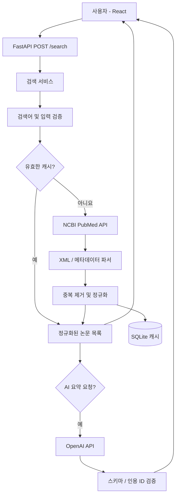

# Canine Evidence Engine

> 반려동물 유전자·변이와 종양 관련 연구 근거를 **검색·정리·추적**하는 Python 기반 연구 보조 서비스

**프로젝트 상태:** 실제 PubMed 검색, FastAPI, React 문헌 검색 화면 (Streamlit 임시 보존)  
**대상 사용자:** 반려동물 유전체·암 연구에 관심 있는 개발자, 연구 담당자, 수의학 전문가  
**초기 대상 종:** 개(*Canis lupus familiaris*) 중심, 추후 고양이 확장  
**목적:** 진단이 아닌 **문헌 검색과 근거 탐색**

## 1. 프로젝트 배경

반려동물 유전자 검사 결과지에는 `TP53`, `BRAF`, `KIT`, `PIK3CA` 같은 유전자명이 포함될 수 있다. 하지만 유전자명 하나만으로 특정 종·암종·변이의 임상적 의미를 결론 내릴 수 없다. 관련 연구는 서로 다른 종, 암종, 연구 설계, 검체 유형 및 변이를 다루므로 문헌을 구분하고 원문 근거를 추적하는 일이 중요하다.

이 프로젝트는 사용자가 유전자명과 선택적인 종·암종을 입력하면 **출처가 확인된 논문을 검색**, 연구 메타데이터와 초록을 정규화하고, 관련성을 확인할 수 있는 **근거 카드**를 제공한다. 선택적으로 OpenAI API를 사용해 *제공된 근거 범위 안에서만* 읽기 쉬운 한국어 요약을 생성한다.

### 목표
- 유전자명 기반 논문 검색을 자동화한다.
- 개/고양이/사람 연구를 명시적으로 구분한다.
- 원문 출처(PMID/DOI/URL)와 사용한 근거 문장을 추적할 수 있게 한다.
- 논문 목록, 근거 부족, 상충하거나 검증되지 않은 정보 등을 숨기지 않고 보여준다.
- Python 데이터 처리·NLP·검색 평가·API 연동 역량을 쌓는다.
- 회사의 실데이터나 내부 DB에 의존하지 않고 독립적으로 개발한다.

### 하지 않는 일 (Non-goals)
- 암 진단, 환자별 위험도 계산, 예후 예측
- 약물 또는 투여량 추천, 치료 효과 보증
- 단순 유전자명만으로 변이의 임상적 의미 단정
- 사람 암 연구를 개·고양이 임상 근거로 자동 전환
- AI가 PMID/논문/인용 문장을 만들어 내는 행위
- 회사 검사 결과지·환자 개인정보를 초기 MVP에 수집

## 2. 핵심 사용 시나리오

1. 사용자가 검색창에 `BRAF`를 입력한다.
2. 종을 `dog`로 선택하고 (선택) 암종 키워드를 입력한다.
3. 시스템이 검색 조건에 따라 PubMed 논문을 수집한다.
4. 논문 제목, 출판연도, DOI/PMID, 초록, 원문 링크 및 검색 일시를 보여준다.
5. 관련 연구를 **직접 확인된 종 / 종 미확인 / 사람 연구** 등으로 분리한다.
6. 사용자가 논문 카드를 열어 근거를 확인한다.
7. 선택적으로 AI 요약을 생성하되 각 주장과 출처를 연결하고 근거가 없는 내용은 '확인 불가'로 표시한다.

> **설계 원칙:** '논문 검색 결과'와 '검증된 과학적 결론'은 다르다. 단순 키워드 매칭이나 AI 요약만으로 연구의 신뢰성·임상 적용성을 판정하지 않는다.

## 3. MVP 범위

### P0 — 필수 (첫 작동 버전)
- [ ] 유전자명으로 논문 검색 (`TP53`, `BRAF` 등)
- [ ] 검색 조건: 종(`dog`, `cat`, `human`, `all`), 기간, 선택적 암종 키워드
- [ ] PubMed 검색: ESearch → EFetch/ESummary로 제목·초록·저자·연도·PMID/DOI 확보
- [ ] 중복 제거: PMID 우선, DOI 보조
- [ ] 검색 결과 카드와 원본 링크
- [ ] API 오류, 검색 결과 없음, 초록 없음 구분
- [ ] 모든 결과에 출처 및 검색 시각 기록
- [ ] 10~20개의 사전 정의된 검색어로 검색 동작 테스트

### P1 — 근거 기반 요약
- [ ] AI 요약은 **가져온 초록/허용된 원문 발췌**에서만 작성
- [ ] 출처별 지원 문장 또는 근거 발췌 표시
- [ ] 종·암종·정확한 변이 표기를 임의로 보완하지 않음
- [ ] 인용 대상 PMID가 입력 문헌 목록에 실제로 존재하는지 코드로 검증
- [ ] 자료 부족/상충 시 단정 대신 불확실성 표시
- [ ] AI 기능을 끄더라도 검색 기능은 정상 작동

### P2 — 품질과 확장
- [ ] 연구 종류·종 분류를 사람이 검토할 수 있는 UI
- [ ] 검색 정확도 평가용 골든셋 구축
- [ ] 캐시, 검색 기록, 결과 내보내기(CSV/JSON)
- [ ] 선택: Europe PMC 연동 및 공개 전문 접근 가능 여부 표시
- [ ] 선택: 유전자 공식 식별자/별칭 정규화(NCBI Gene 등)
- [ ] 선택: 정확한 HGVS 변이 표기와 종별 reference genome을 입력받는 변이 단위 검색

**초기에는 자동 '근거 등급'을 매기지 않는다.** 연구 질 평가에는 전문 검토가 필요하고, 키워드 또는 LLM 단독 판정은 검증되지 않았다.

## 4. 데이터 출처와 경계

| 출처 | 용도 | 초기 적용 |
| --- | --- | --- |
| [NCBI E-utilities](https://www.ncbi.nlm.nih.gov/home/develop/api/) | PubMed 검색, PMID 기반 메타데이터 조회 | 필수 |
| [PubMed](https://pubmed.ncbi.nlm.nih.gov/) | 검색된 논문 원본 확인 | 필수 |
| [NCBI Gene](https://www.ncbi.nlm.nih.gov/gene/) | 유전자 식별자, 종별 유전자명·별칭 교차 검토 | 추후 |
| [Europe PMC REST API](https://europepmc.org/RestfulWebService) | 문헌 검색 보완, 전문 접근 가능 여부 확인 | 추후 |
| [OpenAI Structured Outputs](https://developers.openai.com/api/docs/guides/structured-outputs) | 출처 필드가 있는 일관된 요약 JSON 생성 | P1, 선택 |

**주의 사항**
- 검색 API의 요청 제한, 이용 정책, 저작권 및 전문 재사용 조건을 준수한다.
- 초록이 없으면 '초록 없음'으로 표시하며 원문 내용을 추정하지 않는다.
- 논문에 개·고양이 관련 키워드가 있다고 실제 실험 대상 종이라고 단정하지 않는다.
- PubMed 검색 결과에 보이지 않는 연구가 있을 수 있으므로 '연구 없음' 대신 '설정한 조건에서 검색된 연구 없음'으로 표현한다.
- 최초 버전은 초록 기반이다. 초록만으로 확인할 수 없는 상세 실험 결과는 별도 표시한다.

## 5. 추천 기술 스택

| 영역 | 기술 | 이유 |
| --- | --- | --- |
| 언어 | Python 3.12+ | 데이터 수집·정제·NLP와 과학 Python 생태계 활용 |
| API 서버 | FastAPI + Pydantic | 명시적 스키마, 검증, 비동기 HTTP 연동 |
| 문헌 수집 | `httpx` + NCBI E-utilities | 외부 API 호출·타임아웃·재시도 제어 |
| 파싱·처리 | 표준 XML 파서, `pandas`(필요 시) | PubMed XML/구조화 데이터 정규화 |
| 저장 | SQLite (로컬 MVP) | 서버 DB 없이 검색 캐시 및 기록 관리 |
| UI | React + TypeScript + Tailwind CSS | 기본 프론트엔드, 기존 Streamlit 임시 보존 |
| AI | OpenAI API (선택) | 출처에 제한된 한국어 요약, 구조화된 출력 |
| 테스트 | pytest, respx | API 응답 모킹과 변환 로직 테스트 |

**결정:** 처음부터 React 프론트엔드·PostgreSQL·벡터 DB·Docker·RAG를 모두 도입하지 않는다. 검색 품질이 검증되고 규모가 커질 때 필요성을 다시 평가한다.

## 6. 시스템 설계



### 책임 분리
- `clients/`: 외부 API 호출, 지연·에러·재시도 처리
- `services/`: 검색 조건 구성, 논문 결합, 캐시, AI 오케스트레이션
- `parsers/`: XML/JSON → 내부 모델 변환
- `models/`: 요청·논문·요약의 Pydantic 스키마
- `validators/`: 출처 검증, 인용 ID 검증, 허용 범위 검증
- `ui/`: 검색/필터/논문 카드/요약 화면

### 권장 디렉터리 구조 (계획)

```text
canine-evidence-engine/
├── README.md
├── pyproject.toml
├── .env.example
├── src/
│   └── canine_evidence/
│       ├── __init__.py
│       ├── config.py
│       ├── models/
│       │   ├── article.py
│       │   └── search.py
│       ├── clients/
│       │   ├── ncbi.py
│       │   └── openai_client.py
│       ├── parsers/
│       │   └── pubmed_xml.py
│       ├── services/
│       │   ├── search_service.py
│       │   ├── article_service.py
│       │   └── summarization_service.py
│       ├── validators/
│       │   └── citation_validator.py
│       └── storage/
│           └── sqlite.py
├── frontend/
│   └── app.py
├── tests/
│   ├── fixtures/
│   ├── test_pubmed_parser.py
│   ├── test_search_service.py
│   └── test_citation_validator.py
└── docs/
    ├── architecture.md
    ├── data-contracts.md
    └── evaluation.md
```

## 7. 핵심 데이터 모델 (초안)

### SearchRequest

```json
{
  "gene": "BRAF",
  "species": "dog",
  "cancer_keyword": null,
  "year_from": 2015,
  "year_to": 2026,
  "limit": 20
}
```

### Article

```json
{
  "pmid": "<real-pmid-from-source>",
  "doi": null,
  "title": "<title-from-source>",
  "publication_year": 2024,
  "abstract": "<abstract-from-source-or-null>",
  "journal": "<journal-from-source>",
  "source_url": "https://pubmed.ncbi.nlm.nih.gov/<real-pmid-from-source>/",
  "retrieved_at": "2026-10-27T00:00:00Z",
  "species_status": "unverified"
}
```

> 위 값은 **필드 형태를 설명하는 계약 예시**이며 실재 논문을 나타내지 않는다. `<...>` 값과 연도는 데이터 예시일 뿐 실제 응답에 사용해서는 안 된다.

### EvidenceSummary (P1)
- `question`: 사용자의 검색 질의
- `claims[]`: 주장 텍스트, `supporting_pmids[]`, `supporting_excerpts[]`, `limitations[]`
- `unresolved_questions[]`: 근거 부족 또는 판단 불가 항목
- `generated_at`: 요약 시각

각 주장의 PMID는 해당 검색 결과에 실제로 존재하는지 검증한다. **형식 검증은 사실성 검증을 보장하지 않으므로** 원문 발췌와 주장 간 연결은 별도 점검한다.

## 8. 검색·신뢰성 정책

### 검색
1. 사용자 입력의 길이·형식 검증 및 정규화
2. 유전자/종/암종 조건으로 PubMed 검색식 생성
3. PMID 목록 조회 후 배치로 문헌 데이터 가져오기
4. 페이지 단위 처리, 중복 제거, 오류·타임아웃 재시도
5. 검색식·조회 시각·결과 건수 함께 저장

**종 필터는 검색 결과의 후보를 좁히는 수단이며 종을 확정하는 수단이 아니다.** 초록·본문과 종 메타데이터로 실제 연구 대상을 확인하거나 `unverified`로 보류한다.

### AI 요약 (P1)
- 입력: 사용자 질문 + 검색된 문헌의 식별자·메타데이터·허용된 발췌
- 출력: 구조화된 주장, 근거 PMID, 발췌, 주의점
- 처리: 모델의 PMID를 프로그램이 대조하고, 증거 없는 주장은 표시하지 않거나 검토 대상으로 돌린다.
- **AI 결과는 수의학적 판단 또는 의학적 권고가 아니다.**
- 모든 공개 화면에 '제공된 문헌 범위 기준' 문구와 마지막 검색 시각을 표시한다.

## 9. 품질 평가 계획

### 자동 테스트
- XML 필드 누락, 초록 없음, DOI 없음
- 중복 PMID, 중복 DOI, 깨진/잘못된 외부 응답
- 429/5xx/타임아웃에 대한 제한적 재시도
- 서로 다른 종 논문 혼합 및 종 미확인 상태
- AI가 검색 결과에 없는 PMID를 인용하는 경우 차단

### 수동·반자동 평가
- **검색 정확성:** 검증된 검색어 샘플에서 관련 문헌이 검색되는지 확인
- **서지 정확성:** PMID/DOI/제목/연도 원본 일치 여부
- **근거 연결:** 주장마다 인용 문헌에 실제 지원 문장이 있는지 검토
- **환각률:** 존재하지 않는 PMID, 지원되지 않는 주장 비율
- **종 혼동률:** 사람 연구를 개 연구로 잘못 분류한 비율
- **재현성:** 검색식, 데이터 조회일, 모델 버전 및 프롬프트 버전 기록

테스트 데이터에 대한 정답/평가는 별도로 기록하고, 단일 정확도 수치를 임상적 신뢰도처럼 소개하지 않는다.

## 10. 개발 로드맵

### Phase 1 — 검색 엔진 (최우선)
- 프로젝트 환경/패키지 구성
- NCBI API 연결
- PubMed XML 파싱과 논문 데이터 모델
- `BRAF`, `TP53` 검색의 실제 응답 확인
- Streamlit 목록 UI 및 원본 링크
- pytest로 오류 처리 검증

**완료 기준:** AI 없이도 실제 논문을 검색하고 제목·초록·PMID·링크를 확인할 수 있다.

### Phase 2 — 정규화·품질
- 검색 조건(종/암종/연도) 고도화
- 종 확인 상태 분리 및 UI 표시
- 캐시·페이지네이션·검색 이력
- 정확성 평가 골든셋 생성

**완료 기준:** 사람이 검색 근거를 재확인할 수 있고, 종 혼동과 누락을 측정할 수 있다.

### Phase 3 — 근거 기반 AI 요약
- OpenAI Structured Outputs 연동
- 주장–PMID–발췌 구조 구현
- 출처 유효성 및 지원 여부 검사
- 요약 실패/근거 부족 UI

**완료 기준:** 존재하지 않는 출처를 표시하지 않고, 검색 원문과 요약을 나란히 검토할 수 있다.

### Phase 4 — 선택적 확장
- Europe PMC, Gene API 도입
- 유전자 별칭/정확한 변이 검색
- CSV/JSON 내보내기
- 외부 연구자/수의사 피드백을 통한 품질 개선

## 11. 실행 환경 및 실행 방법

Python **3.12**, Conda **canine-evidence** 환경을 사용한다. 모든 명령은 프로젝트
루트에서 실행한다. 프론트엔드와 백엔드는 같은 Git 저장소에 있다.

```bash
# 새 환경이 필요한 경우:
conda env create -f environment.yml
conda activate canine-evidence
# 기존 환경에서는 의존성 갱신:
python -m pip install -e '.[dev]'
```

루트 `.env`에 본인의 `NCBI_EMAIL`을 설정한다. `NCBI_API_KEY`는 선택이다.
`.env.example`은 형식 참고용이며, 이미 설정한 `.env`를 덮어쓰지 않는다.
프론트엔드는 NCBI 인증 정보를 읽거나 전송하지 않는다.

**터미널 1 — FastAPI**

```bash
conda activate canine-evidence
uvicorn canine_evidence.api:app --host 127.0.0.1 --port 8000
```

API 계약과 시험 화면: http://127.0.0.1:8000/docs

**터미널 2 — React (기본 프론트엔드)**

Node.js 22.12 이상 또는 24 LTS 환경에서 실행한다. Python 백엔드는 기존 Conda
환경을 그대로 사용한다.

```bash
cd frontend
npm ci
npm run dev
```

브라우저에서 Vite가 출력하는 로컬 주소(기본 http://127.0.0.1:5173)를 연다.
React는 `/api/search`를 호출하고 Vite 프록시는 FastAPI의 `/search`로 전달한다.
기본 백엔드는 `http://127.0.0.1:8000`이며, 다른 포트는 Vite 실행 시 설정한다.

```bash
CANINE_API_URL=http://127.0.0.1:8000 npm run dev
```

백엔드의 `.env`를 프론트엔드에 복사하지 않는다. NCBI 이메일과 API 키는 브라우저에
전달하지 않는다. Vite 프록시는 개발용이며 배포 시 동일 출처 프록시 설정이 필요하다.

```bash
npm run test
npm run typecheck
npm run build
```

프로덕션 빌드는 `frontend/dist/`에 생성된다. 정적 빌드만으로는 FastAPI 프록시가
제공되지 않는다. 이번 작업에는 배포 구성이 포함되지 않는다.

**기존 Streamlit — 임시 보존**

```bash
conda activate canine-evidence
streamlit run frontend/app.py --server.address 127.0.0.1 --server.port 8501 --browser.gatherUsageStats false
```

브라우저에서 http://127.0.0.1:8501 을 연다. 유전자명, 종 검색 필터, 결과 개수,
선택적 연도 범위·암종 키워드를 입력한다. Streamlit은 FastAPI `POST /search`만
HTTP로 호출한다. 백엔드 주소를 바꾸려면 프론트엔드 프로세스의 환경변수
`CANINE_API_URL`을 설정한다(기본 `http://127.0.0.1:8000`).

```bash
CANINE_API_URL=http://127.0.0.1:8000 streamlit run frontend/app.py
```

화면에는 전체 검색 건수·반환 건수·UTC 검색 시각·부분 성공 여부와 논문별
제목·저자·연도·DOI·초록·PMID·PubMed 링크를 표시한다. 누락된 값은 ‘정보 없음’으로
표시한다. 종 상태는 모두 **unverified**이며 MeSH 종 필터는 실제 연구 대상 종의
확정을 의미하지 않는다. 초록 기반 문헌 탐색 결과이며 임상적 판단을 제공하지 않는다.

서버 연결 실패, 입력 오류, NCBI 오류, 전체 수집 실패, 부분 성공, 정상 0건을 구분한다.
오류 시 입력은 유지하고 이전 검색 결과는 지워 오해를 방지한다. 화면 재실행을 위한
현재 결과만 세션 메모리에 유지하며 검색 캐시나 DB는 사용하지 않는다.

**테스트**

```bash
python -m pytest -q
NCBI_LIVE_TEST=1 python -m pytest -m live_api -q -s
```

기본 테스트는 외부 NCBI 호출 없이 실행한다. live 테스트는 유효한 NCBI 설정과
네트워크 연결이 필요하다. 기존 Streamlit 테스트는 AppTest로 실행한다. React 테스트는 frontend/에서 npm run test로 실행하며 실제 응답 fixture와 HTTP Mock을 사용한다.

**현재 범위와 제한**

- SQLite 캐시, AI 요약, 종 확정 알고리즘, 로그인, 배포는 구현하지 않았다.
- 백엔드는 단일 worker로 실행한다. 여러 프로세스의 NCBI 호출 제한 합산은 미지원이다.
- UI 응답 대기는 180초이며, 초과 시 서버 검색이 계속 진행 중일 수 있다.
- API 키, 개인 이메일, `.env`를 Git이나 로그에 기록하지 않는다.
- 구현된 API 상세와 설계 차이는 `docs/stage2.md`를 참고한다.

## 12. 주요 설계 결정

| 결정 | 이유 |
| --- | --- |
| 개 연구부터 시작 | 종 구분과 범위를 명확히 해 복잡도 관리 |
| PubMed 하나로 먼저 구현 | 외부 데이터 소스 수를 통제하고 결과 품질 먼저 확보 |
| 검색 먼저, AI 나중 | 데이터 수집·정규화가 잘못되면 요약도 신뢰할 수 없음 |
| SQLite + Streamlit 시작 | 초기 운영 부담 없이 Python 핵심 로직에 집중 |
| RAG/벡터 DB 보류 | 초기 규모에서는 문헌 API 검색과 메타데이터 필터가 우선 |
| 모델 직접 학습 비필수 | 프로젝트의 목표는 근거 검색 및 추적이지 학습 자체가 아님 |
| 의학적 결론 자동화 제외 | 검증되지 않은 치료 권고·진단 해석 방지 |

## 13. 향후 확인할 사항 (코딩을 막지 않는 항목)

- 회사 활용 시 실제 사용자가 연구자, 수의사, 일반 보호자 중 누구인지
- 문헌 관련성 판단 기준을 누가 검토할지
- 추후 회사 문서 연동이 필요할 경우 권한과 개인정보 처리 기준
- 공개 자료의 저작권·재배포 범위

초기 개발은 회사 내부 자료 없이 독립 실행 가능하도록 진행한다.

---

### 참고 문서
- [NCBI API](https://www.ncbi.nlm.nih.gov/home/develop/api/)
- [PubMed](https://pubmed.ncbi.nlm.nih.gov/)
- [Europe PMC REST API](https://europepmc.org/RestfulWebService)
- [OpenAI Structured Outputs](https://developers.openai.com/api/docs/guides/structured-outputs)

> **면책:** 본 프로젝트는 연구 문헌 탐색 및 교육·개발 목적으로 설계한다. 반려동물의 진단, 처방, 치료 결정에 사용해서는 안 된다.
